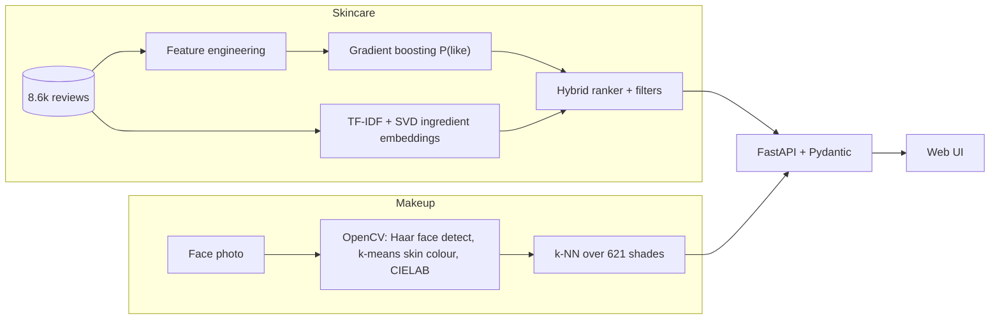

# AI Cosmetic Recommendation System

Two features behind one REST API:

1. **Skincare recommender (machine learning).** Ranks 315 skincare products using a model trained on 8,649 real reviews.
2. **Makeup shade matcher (computer vision).** Upload a face photo; OpenCV measures your skin colour and a k-NN search finds the closest real foundation shades from 36 brands (621 shades).

**Stack:** Python, scikit-learn, OpenCV, pandas/NumPy, FastAPI, Pydantic, joblib, Docker, GitHub Actions, pytest, ruff.



## Feature 1: skincare (ML)
- **Gradient boosting classifier** (`HistGradientBoostingClassifier`) predicts P(user rates a product 4+ stars) from skin type, tone, category, brand, price, site rating, suitability labels and ingredient embedding.
- **NLP-style ingredient embeddings:** TF-IDF over ingredient lists, then truncated SVD (LSA). Cosine similarity finds products like ones the user already liked.
- The two scores are z-scored and blended. **Hard filters** (category, budget, sensitive skin, ingredients to avoid) run first, and every result carries a plain-English reason.
- Trained, cross-validated and serialized to `models/skincare_model.joblib` with metadata (`python -m cosmetic_rec.train`).

### Results (`python -m cosmetic_rec.evaluate`)
**A. Will a user rate it 4+ stars?** 5-fold CV grouped by user. AUC is ranking quality; Brier and ECE measure whether the probabilities can be trusted (lower is better):

| Model | AUC | Brier | ECE |
|---|---|---|---|
| Baseline: site rating | 0.591 | n/a | n/a |
| Logistic regression | 0.593 | 0.184 | 0.033 |
| Neural net (MLP) | 0.581 | 0.186 | 0.041 |
| Gradient boosting | 0.595 | 0.184 | 0.026 |
| **Gradient boosting + calibration (used)** | **0.600** | **0.184** | **0.021** |

**B. Find the hidden product.** One liked product per user is hidden (417 users, ~315 candidates). HitRate@10 averaged over 5 seeds:

| Model | HitRate@10 |
|---|---|
| Random | 3.2% |
| ML P(like) only | 3.5% |
| Ingredient similarity only | 8.2% |
| **Hybrid (used)** | **8.2%** |

**C. Review sentiment (NLP).** TF-IDF + logistic regression on review text, 5-fold CV grouped by user, 7,498 de-duplicated reviews:

| Metric | Value |
|---|---|
| ROC-AUC | 0.956 |
| Accuracy | 87.5% (always guessing "positive": 74.7%) |
| F1 on negative reviews | 0.69 |

**D. Does the AICosmetic score predict held-out reviews?** ROC-AUC, users never shared between train and test:

| Predictor | AUC |
|---|---|
| Site rating | 0.591 |
| Reviews only (smoothed positive share) | 0.595 |
| ML model only (calibrated) | 0.600 |
| **AICosmetic score (blend)** | **0.599** |

**Honest reading:** the data is small and most users wrote one review, so predicting one person's rating from the product is hard (AUC about 0.6 whichever way it is done, barely above the site rating; a neural net did not help, and blending model and reviews into the score did not beat its parts). The score's value is that it is calibrated, personalised and explainable. The text model, by contrast, is genuinely strong (0.956), because it reads what the same reviewer wrote. Ingredient similarity is what clearly beats chance (about 2.6x random).

**Data leakage found and fixed:** the original notebook reported 100% accuracy because its label `Good_Stuff` is exactly `Rating_Stars == 5` and `Rating_Stars` was an input feature. The dataset also contains repeat user/product reviews that can leak a held-out item; the evaluation removes them.

## Feature 2: makeup shade matching (OpenCV)
1. Haar-cascade **face detection**, largest face.
2. Sample the cheek/forehead region; keep skin-coloured pixels (YCrCb range).
3. Convert to **CIELAB**; **k-means** (k=3) picks the dominant skin colour.
4. **Individual Typology Angle** gives a tone label (Porcelain to Ebony).
5. **k-nearest-neighbours** in Lab space returns the closest shade per foundation product, with a colour difference (delta E; under about 2 is hard to see by eye).

**Limits:** it reads colour from pixels, so lighting and camera white balance matter; a swatch colour on a screen is not the same as foundation on skin. Checked on one portrait plus synthetic brightness changes, not a labelled, diverse test set. Treat results as a shortlist. Photos are processed in memory and never stored.

## Reviews and the AICosmetic score
Each product gets review themes (hydration, breakouts, irritation, scent, texture, results, gentleness, value, packaging), judged as praised, criticised or typical relative to other products, plus pros, cons and short representative quotes. The **AICosmetic score** (0-100) blends the model's calibrated probability, the smoothed positive-review share (matched to your skin type when enough reviewers share it) and, if you have concerns, ingredient fit, minus a penalty for ingredients often reported as aggravating. Every response shows the points each part contributed. Verdicts (Recommended 80+, Okay 70+, Caution) are relative to this catalog. Formula: [cosmetic_rec/score.py](cosmetic_rec/score.py).

## Skin concern assessment
An 8-question quiz (plus selected concerns and optional photo hints) scores concerns such as acne, dryness, redness and dark spots, each with the reasons behind it, helpful ingredients, ingredients to watch and a tip. Concerns re-rank skincare results by ingredient fit. It is rule-based and **not a diagnosis**; the ingredient table is general guidance, not validated against outcomes. Photo hints (redness, shine, blemishes) are low confidence and were only checked on synthetic patches.

## Roadmap
See [docs/PLAN.md](docs/PLAN.md) for the phased plan (data sources, concern assessment, review summaries and score, makeup palettes, routine builder, architecture) and [docs/FRONTEND.md](docs/FRONTEND.md) for the frontend contract.

## API (OpenAPI docs at `/docs`)
The `/api/v1/*` endpoints are the contract the web UI uses (`/options`, `/face/analyze`, `/skin/assess`, `/consult`, `/products/{id}`). Sections not built yet return `status: "planned"` with the final response shape.

Legacy endpoints:
| Endpoint | Purpose |
|---|---|
| `POST /skincare/recommend` | ranked skincare products with reasons |
| `GET /skincare/products?q=` | search products |
| `POST /face/analyze` | photo bytes to skin colour + tone |
| `POST /makeup/match-photo?k=&brand=` | photo bytes to closest foundation shades |
| `GET /makeup/match?hex=` | shades for a skin-colour hex, no photo |
| `GET /makeup/brands`, `/health`, `/model-info` | metadata, health check, model version and CV metrics |

```bash
curl -X POST localhost:8000/skincare/recommend -H 'content-type: application/json' \
  -d '{"skin_type":"Dry","category":"Moisturizer","max_price":50,"avoid_ingredients":["fragrance"],"k":3}'
curl -X POST --data-binary @selfie.jpg "localhost:8000/makeup/match-photo?k=5"
```

## Run
```bash
make install && make train && make run     # http://localhost:8000
make test        # 18 tests: filters, leakage-free split, colour math, API, error handling
make lint        # ruff
make docker      # image trains the model at build time and has a health check
```
CI (GitHub Actions) runs lint, tests and training on every push.

## Engineering notes
Pydantic request validation, request-timing middleware (`X-Process-Time-ms`) with logging, versioned model artifact with recorded metrics, model loaded once at startup, 413/400/422 error handling, type hints throughout.

## Layout
```
cosmetic_rec/  data.py recommender.py train.py evaluate.py makeup.py vision.py api.py
data/          skindataall.csv (reviews)   foundation_shades.csv (shades)
static/        index.html (placeholder UI)
tests/         pytest suite
```

## Optional: live web search
Copy `.env.example` to `.env` and set `TAVILY_API_KEY` (a [Tavily](https://tavily.com) key; `.env` is git-ignored). Without it the endpoint reports `disabled` and everything else works.

## Data credits
- Extra products: [Open Beauty Facts](https://world.openbeautyfacts.org) (database under ODbL, contents under CC BY-SA 3.0). Trimmed by `scripts/prepare_obf.py` into `data/obf_cosmetics.csv`. Redistribution of derived data keeps the same licence and attribution.
- Skincare reviews: `skindataall.csv`, from the original project dataset.
- Foundation shades: [The Pudding, "Beauty Brawl" (2018)](https://github.com/the-pudding/data/tree/master/makeup-shades), hex swatches collected from brand websites. The repository states no license, so it is used here for education and portfolio purposes only.
