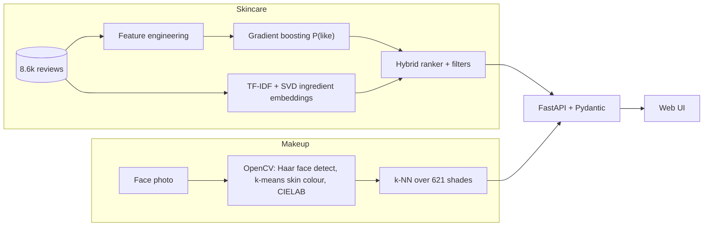

# AI Cosmetic Recommendation System

Two features behind one REST API:

1. **Skincare recommender (machine learning).** Ranks 315 skincare products using a model trained on 8,649 real reviews.
2. **Makeup shade matcher (computer vision).** Upload a face photo; OpenCV measures your skin colour and a k-NN search finds the closest real foundation shades from 36 brands (621 shades).

**Stack:** Python, scikit-learn, OpenCV, pandas/NumPy, FastAPI, Pydantic, joblib, Docker, GitHub Actions, pytest, ruff.



## Feature 1: skincare (ML)
- **Gradient boosting classifier** (`HistGradientBoostingClassifier`) predicts P(user rates a product 4+ stars) from skin type, tone, category, brand, price, site rating, suitability labels and ingredient embedding.
- **NLP-style ingredient embeddings:** TF-IDF over ingredient lists, then truncated SVD (LSA). Cosine similarity finds products like ones the user already liked.
- The two scores are z-scored and blended. **Hard filters** (category, budget, sensitive skin, ingredients to avoid) run first, and every result carries a plain-English reason.
- Trained, cross-validated and serialized to `models/skincare_model.joblib` with metadata (`python -m cosmetic_rec.train`).

### Results (`python -m cosmetic_rec.evaluate`)
**A. Will a user rate it 4+ stars?** 5-fold CV grouped by user, ROC-AUC:

| Model | AUC |
|---|---|
| Baseline: site rating | 0.591 |
| Logistic regression | 0.591 |
| Neural net (MLP) | 0.554 |
| **Gradient boosting (used)** | **0.599** |

**B. Find the hidden product.** One liked product per user is hidden (417 users, ~315 candidates). HitRate@10 averaged over 5 seeds:

| Model | HitRate@10 |
|---|---|
| Random | 3.2% |
| ML P(like) only | 3.5% |
| Ingredient similarity only | 8.3% |
| **Hybrid (used)** | **8.6%** |

**Honest reading:** the data is small and most users wrote one review, so predicting satisfaction is hard (AUC about 0.6, barely above the site rating; a neural net did not help). Ingredient similarity is what clearly beats chance (about 2.7x random).

**Data leakage found and fixed:** the original notebook reported 100% accuracy because its label `Good_Stuff` is exactly `Rating_Stars == 5` and `Rating_Stars` was an input feature. The dataset also contains repeat user/product reviews that can leak a held-out item; the evaluation removes them.

## Feature 2: makeup shade matching (OpenCV)
1. Haar-cascade **face detection**, largest face.
2. Sample the cheek/forehead region; keep skin-coloured pixels (YCrCb range).
3. Convert to **CIELAB**; **k-means** (k=3) picks the dominant skin colour.
4. **Individual Typology Angle** gives a tone label (Porcelain to Ebony).
5. **k-nearest-neighbours** in Lab space returns the closest shade per foundation product, with a colour difference (delta E; under about 2 is hard to see by eye).

**Limits:** it reads colour from pixels, so lighting and camera white balance matter; a swatch colour on a screen is not the same as foundation on skin. Checked on one portrait plus synthetic brightness changes, not a labelled, diverse test set. Treat results as a shortlist. Photos are processed in memory and never stored.

## API (OpenAPI docs at `/docs`)
| Endpoint | Purpose |
|---|---|
| `POST /skincare/recommend` | ranked skincare products with reasons |
| `GET /skincare/products?q=` | search products |
| `POST /face/analyze` | photo bytes to skin colour + tone |
| `POST /makeup/match-photo?k=&brand=` | photo bytes to closest foundation shades |
| `GET /makeup/match?hex=` | shades for a skin-colour hex, no photo |
| `GET /makeup/brands`, `/health`, `/model-info` | metadata, health check, model version and CV metrics |

```bash
curl -X POST localhost:8000/skincare/recommend -H 'content-type: application/json' \
  -d '{"skin_type":"Dry","category":"Moisturizer","max_price":50,"avoid_ingredients":["fragrance"],"k":3}'
curl -X POST --data-binary @selfie.jpg "localhost:8000/makeup/match-photo?k=5"
```

## Run
```bash
make install && make train && make run     # http://localhost:8000
make test        # 18 tests: filters, leakage-free split, colour math, API, error handling
make lint        # ruff
make docker      # image trains the model at build time and has a health check
```
CI (GitHub Actions) runs lint, tests and training on every push.

## Engineering notes
Pydantic request validation, request-timing middleware (`X-Process-Time-ms`) with logging, versioned model artifact with recorded metrics, model loaded once at startup, 413/400/422 error handling, type hints throughout.

## Layout
```
cosmetic_rec/  data.py recommender.py train.py evaluate.py makeup.py vision.py api.py
data/          skindataall.csv (reviews)   foundation_shades.csv (shades)
static/        index.html (placeholder UI)
tests/         pytest suite
```

## Data credits
- Skincare reviews: `skindataall.csv`, from the original project dataset.
- Foundation shades: [The Pudding, "Beauty Brawl" (2018)](https://github.com/the-pudding/data/tree/master/makeup-shades), hex swatches collected from brand websites. The repository states no license, so it is used here for education and portfolio purposes only.
